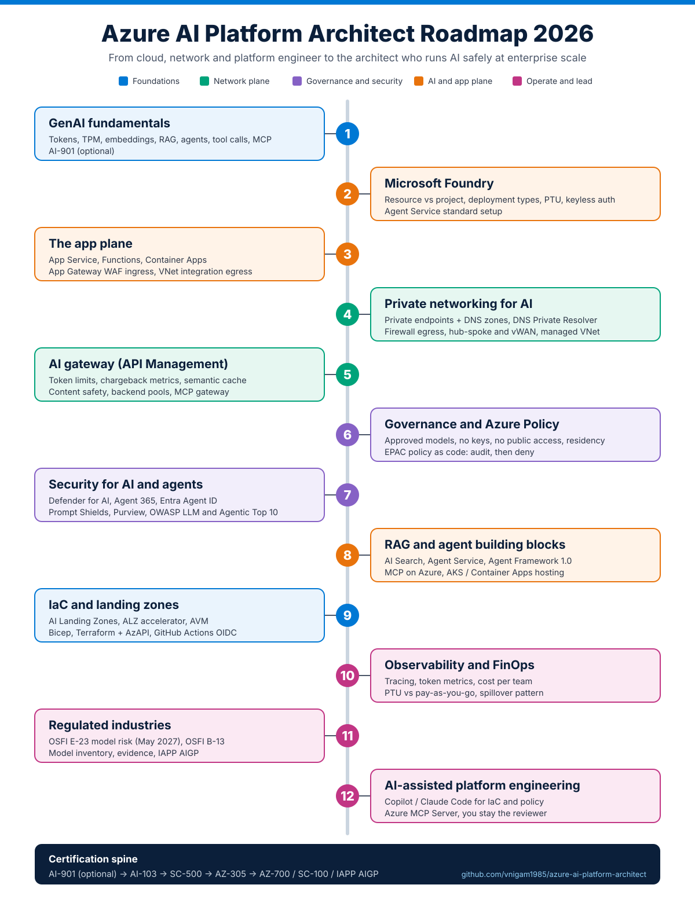
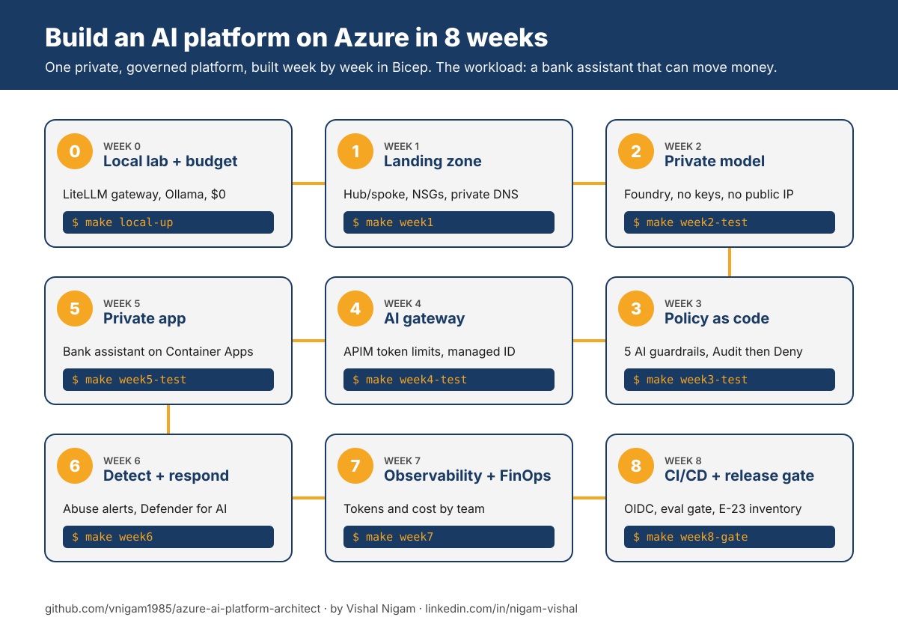

# Azure AI Platform Architect Roadmap 2026

> A step-by-step guide to becoming a **Cloud AI Platform Architect on Microsoft Azure**, with free and paid learning resources, working code (Bicep, Terraform, Azure Policy, APIM policies, KQL), hands-on labs and interview prep.

<p align="left">
  <a href="https://www.linkedin.com/in/nigam-vishal/"></a>
  <a href="https://www.youtube.com/@thrivewithvishal"></a>
  <a href="https://www.instagram.com/thrivewithvishal"></a>
  <a href="https://vnigam1985.github.io"></a>
  <a href="https://mentoraccelerate.com/90-day-job-search-framework"></a>
</p>

Most AI roadmaps teach you to build a chatbot. This one teaches you to build the **platform** every chatbot, agent and RAG app in a large company runs on: private networking, identity, guardrails, an AI gateway, observability and cost control. That's the part enterprises struggle with, and the part they pay architects for.

It's written for cloud, platform, network and DevOps engineers who already know Azure infrastructure and want to move into AI. If you know VNets, firewalls, route tables and Azure Policy, you already have half of this job.



📄 [Download the roadmap as a PDF](assets/roadmap.pdf)

## ⭐ Give a Star

If this helps you learn or plan your career, please give it a star. It helps other engineers find it.

## ⚠️ Disclaimer

Azure AI moves fast. In 2026 alone Microsoft renamed Azure AI Foundry to **Microsoft Foundry**, retired AI-102, AI-900 and AZ-500, shipped Microsoft Agent Framework 1.0 and deprecated ALZ-Bicep. Every link here was checked in **October 2026** (see [VERIFICATION.md](VERIFICATION.md)). If something looks out of date, open an issue.

This roadmap shows the landscape. You don't need every tool on it. Learn the fundamentals deeply, then pick what your organization actually uses.

---

## Table of Contents

- [🚀 The 8-week build-along course](#-new-the-8-week-build-along-course)
- [How to use this repo](#how-to-use-this-repo)
- [The role in one picture](#the-role-in-one-picture)
- [Learning path (mostly free)](#learning-path-mostly-free)
  1. [GenAI fundamentals for infrastructure people](#1-genai-fundamentals-for-infrastructure-people)
  2. [Microsoft Foundry](#2-microsoft-foundry)
  3. [The app plane: App Service, Functions, Container Apps, App Gateway](#3-the-app-plane)
  4. [Private networking for AI](#4-private-networking-for-ai)
  5. [The AI gateway (Azure API Management)](#5-the-ai-gateway-azure-api-management)
  6. [Governance and Azure Policy for AI](#6-governance-and-azure-policy-for-ai)
  7. [Security for AI and agents](#7-security-for-ai-and-agents)
  8. [RAG and agent building blocks](#8-rag-and-agent-building-blocks)
  9. [Infrastructure as Code and landing zones](#9-infrastructure-as-code-and-landing-zones)
  10. [Observability and FinOps](#10-observability-and-finops)
  11. [Regulated industries (banking and OSFI)](#11-regulated-industries)
  12. [AI-assisted platform engineering](#12-ai-assisted-platform-engineering)
- [Certifications](#certifications)
- [Hands-on labs and portfolio projects](#hands-on-labs-and-portfolio-projects)
- [Interview preparation](#interview-preparation)
- [Tools](#tools)
- [Where to keep learning](#where-to-keep-learning)
- [Repository map](#repository-map)
- [Contribution](#contribution)
- [About the author](#-about-the-author)

---

## 🚀 New: the 8-week build-along course

Reading a roadmap doesn't make you an architect. Building one platform end to end does. The course builds a **private, governed AI platform on Azure** in Bicep, one layer a week, and runs a real workload on it: a bank assistant (RAG chatbot plus an agent that can move money).



| Week | Topic | You build | Command | Branch |
| --- | --- | --- | --- | --- |
| 0 | [Setup and local lab](weeks/00-setup-and-local-lab/README.md) | The whole request path on your laptop for $0 (LiteLLM gateway + Ollama), then a budget alert | `make local-up` | `week-00` |
| 1 | [Landing zone](weeks/01-landing-zone/README.md) | Hub/spoke VNets, NSGs, private DNS, Log Analytics | `make week1` | `week-01` |
| 2 | [Private model](weeks/02-private-model/README.md) | Foundry gpt-4.1-mini with no keys and no public access, proven from a VM | `make week2-test` | `week-02` |
| 3 | [Policy as code](weeks/03-policy-as-code/README.md) | 5 AI guardrails, Audit then Deny, with negative tests | `make week3-test` | `week-03` |
| 4 | [AI gateway](weeks/04-ai-gateway/README.md) | API Management with token limits, quotas, managed identity, token metrics | `make week4-test` | `week-04` |
| 5 | [Private app](weeks/05-private-app/README.md) | The bank assistant on internal Container Apps, model only via the gateway | `make week5-test` | `week-05` |
| 6 | [Detect and respond](weeks/06-security-monitoring/README.md) | Abuse and cost-attack alerts, policy-deny alerts, Defender for AI | `make week6` | `week-06` |
| 7 | [Observability and FinOps](weeks/07-observability-finops/README.md) | Tokens and estimated cost by team, allowance alerts | `make week7` | `week-07` |
| 8 | [CI/CD and release gate](weeks/08-cicd-release-gate/README.md) | OIDC pipeline, golden-question gate with rollback, OSFI E-23 model inventory | `make week8-gate` | `week-08` |

**Quickstart:** `make local-up && make local-keys && make local-test` (free), then `az login && make week0`.

**Cost:** week 0 is $0. The Azure weeks cost roughly **$25 to $40** if you do weeks 4 to 8 within two weeks and then `make destroy`. Details and the three ways to take the course: [COSTS.md](COSTS.md). Use your own subscription, never your employer's.

**Want to test the AI instead of hosting it?** The companion course [ai-quality-engineer](https://github.com/vnigam1985/ai-quality-engineer) uses the same bank assistant.

---

## How to use this repo

1. **Read the roadmap below in order.** Each step says what to learn, why it matters, and where to learn it.
2. **Do the labs as you go.** Reading doesn't make an architect. Deploying, breaking and fixing does.
3. **Build the portfolio projects.** Fork this repo, then replace the starter code with your own working versions.
4. **Follow the 8-month plan** in [roadmap/8-month-plan.md](roadmap/8-month-plan.md) if you want a weekly schedule (about 8 to 10 hours a week).

Resource tags: **FREE**, **PAID**, **Udemy**, **Video**, **Docs**, **Repo**.

---

## The role in one picture

An AI Platform Architect owns four planes. Most engineers come in strong on one or two.

| Plane | What it covers | Typical starting point |
| --- | --- | --- |
| **Network plane** | Hub-spoke or Virtual WAN, private endpoints, private DNS, firewall egress, routing | Network and platform engineers |
| **Governance plane** | Management groups, Azure Policy, RBAC, landing zones, approved models, data residency | Platform and cloud governance engineers |
| **AI service plane** | Foundry resources and projects, model deployments, Agent Service, AI Search, Content Safety | Data and AI engineers |
| **App and gateway plane** | App Service, Functions, Container Apps, App Gateway/WAF, API Management as AI gateway | App and DevOps engineers |

Microsoft's own enterprise reference architecture, [Baseline Microsoft Foundry chat in an Azure landing zone](https://learn.microsoft.com/en-us/azure/architecture/ai-ml/architecture/baseline-microsoft-foundry-landing-zone), splits ownership exactly this way: the **platform team** owns the hub, firewall egress and DNS; the **workload team** owns the spoke with the AI services. This roadmap makes you able to own both sides.

---

## Learning path (mostly free)

### 1. GenAI fundamentals for infrastructure people

You don't need to train models. You do need to speak the language well enough to design for it: **tokens** (the unit you pay for and get throttled on), **context windows**, **embeddings**, **RAG** (retrieval-augmented generation), **agents and tool calls**, **MCP** (Model Context Protocol), and why model output is **non-deterministic**.

Here you need to learn:
- What a token is and why every quota, limit and bill is measured in tokens per minute (TPM)
- How RAG works end to end: chunking, embeddings, vector search, grounding
- What an agent does differently from a chatbot (it calls tools and takes actions)
- What MCP is and why every enterprise suddenly needs to govern MCP servers

Resources:
- [Microsoft Certified: Azure AI Fundamentals (AI-901)](https://learn.microsoft.com/en-us/credentials/certifications/azure-ai-fundamentals/) learning paths (**FREE**, Docs). Optional exam, $99 USD
- [Get started with AI architecture design](https://learn.microsoft.com/en-us/azure/architecture/ai-ml/) in the Azure Architecture Center (**FREE**, Docs)
- [Model Context Protocol (MCP) Overview: Why You Care!](https://www.youtube.com/watch?v=1Pf2rW5FsqQ) by John Savill (**FREE**, Video)

### 2. Microsoft Foundry

Microsoft Foundry (formerly Azure AI Foundry / AI Studio) is where models, agents and evaluations live. Learn the resource model first, because everything else (networking, RBAC, policy) hangs off it.

Here you need to learn:
- **Foundry resource vs Foundry project.** A Foundry resource (`Microsoft.CognitiveServices/accounts`, kind `AIServices`) holds projects. The older hub-based model is now called **Foundry (classic)**.
- **Model deployment types.** Global, Data Zone and regional (Standard), each in Standard, Provisioned (PTU) and Batch flavours. The type decides where your data can be processed. For a Canadian bank that's a compliance decision, not a performance one.
- **Identity.** Disable API keys (`disableLocalAuth: true`) and use managed identities and Entra RBAC.
- **Agent Service** and its "standard setup" with your own Storage, Cosmos DB and AI Search in your VNet.

Resources:
- [Deployment types for Microsoft Foundry Models](https://learn.microsoft.com/en-us/azure/foundry/foundry-models/concepts/deployment-types) (**FREE**, Docs)
- [What is provisioned throughput for Foundry Models?](https://learn.microsoft.com/en-us/azure/foundry/openai/concepts/provisioned-throughput) (**FREE**, Docs)
- [Develop AI apps and agents on Azure (AI-103T00)](https://learn.microsoft.com/en-us/training/courses/ai-103t00) Microsoft Learn course (**FREE**, Docs)
- [AI-103 Develop AI Apps and Agents on Azure Study Cram](https://www.youtube.com/watch?v=WK2BvjOYTCQ) by John Savill (**FREE**, Video)
- Starter code: [iac/bicep/foundry-private](iac/bicep/foundry-private) and [iac/terraform/foundry-private](iac/terraform/foundry-private) in this repo

### 3. The app plane

Many platform engineers have never deployed the apps that sit in front of AI. You don't need to write them, but you must design their networking and identity.

Here you need to learn:
- **App Service:** VNet integration (outbound), private endpoints (inbound), managed identity
- **Azure Functions:** Flex Consumption and Premium plans with VNet integration
- **Azure Container Apps:** internal environments and workload profiles
- **Application Gateway v2 + WAF:** the standard ingress in front of a private app
- The full path: **user → App Gateway WAF → App Service (private endpoint) → Foundry (private endpoint)**, and egress **App Service → UDR → Azure Firewall**

Resources:
- [Azure-Samples/microsoft-foundry-baseline](https://github.com/Azure-Samples/microsoft-foundry-baseline) (**FREE**, Repo). Single-region baseline with App Gateway WAF, App Service and Foundry Agent Service
- [Azure Architecture Center: AI and machine learning](https://learn.microsoft.com/en-us/azure/architecture/ai-ml/) (**FREE**, Docs)

### 4. Private networking for AI

This is where network engineers win. Every enterprise AI design is mostly a networking and DNS document with a model endpoint attached.

Here you need to learn:
- **Private endpoints and private DNS zones** for every AI dependency. For Foundry and Agent Service, Microsoft lists: `privatelink.cognitiveservices.azure.com`, `privatelink.openai.azure.com`, `privatelink.services.ai.azure.com`, `privatelink.search.windows.net`, `privatelink.documents.azure.com`, `privatelink.blob.core.windows.net` (plus more for hosted agents). See [networking/private-dns-zones.md](networking/private-dns-zones.md).
- **Centralized DNS:** zones in the connectivity subscription, Azure DNS Private Resolver, DeployIfNotExists policy to register records
- **Egress control** through Azure Firewall, and the Foundry **managed virtual network** "allow only approved outbound" mode
- **Hub-spoke vs Virtual WAN** with routing intent for AI workloads
- **Cross-region model access** with APIM backend pools while respecting data residency

Resources:
- [Baseline Microsoft Foundry chat reference architecture in an Azure landing zone](https://learn.microsoft.com/en-us/azure/architecture/ai-ml/architecture/baseline-microsoft-foundry-landing-zone) (**FREE**, Docs). The single most important document in this roadmap
- [Azure-Samples/microsoft-foundry-baseline-landing-zone](https://github.com/Azure-Samples/microsoft-foundry-baseline-landing-zone) (**FREE**, Repo). Deployable reference implementation
- [How to configure network isolation for Microsoft Foundry](https://learn.microsoft.com/en-us/azure/foundry/how-to/configure-private-link) (**FREE**, Docs)
- [Set up private networking for Foundry Agent Service](https://learn.microsoft.com/en-us/azure/foundry/agents/how-to/virtual-networks) (**FREE**, Docs)
- In this repo: [networking/](networking) (DNS zones, egress rules, DNS troubleshooting runbook)

### 5. The AI gateway (Azure API Management)

Every serious enterprise puts a gateway between apps and models. It's where you enforce token limits per team, charge back cost, fail over between regions, cache answers, filter unsafe content and govern MCP servers.

Here you need to learn:
- `llm-token-limit` (tokens per minute and monthly quotas per consumer)
- `llm-emit-token-metric` (token usage by team, app or subscription for chargeback)
- `llm-semantic-cache-lookup` / `llm-semantic-cache-store` (cache similar prompts)
- `llm-content-safety` (block harmful prompts and prompt injection with Prompt Shields)
- **Backend pools with circuit breakers** for multi-region failover and PTU spillover
- **APIM as an MCP gateway**

Resources:
- [AI gateway capabilities in Azure API Management](https://learn.microsoft.com/en-us/azure/api-management/genai-gateway-capabilities) (**FREE**, Docs)
- [Azure-Samples/AI-Gateway](https://github.com/Azure-Samples/AI-Gateway) (**FREE**, Repo). 30+ hands-on labs. Do at least 6 of them
- [About MCP servers in Azure API Management](https://learn.microsoft.com/en-us/azure/api-management/mcp-server-overview) (**FREE**, Docs)
- [Azure API Management with Generative AI](https://www.youtube.com/watch?v=l_8dTUwrqNw) by John Savill (**FREE**, Video)
- In this repo: [gateway/](gateway) (4 policy files checked against Microsoft Learn, plus a Bicep backend pool)

### 6. Governance and Azure Policy for AI

If you already write Azure Policy, you're ahead. AI adds a few new guardrails.

Here you need to learn:
- Built-in policies: AI Services **key access disabled**, **restrict network access**, **use Private Link**; AI Search **disable public access** and **local auth**
- **Foundry model deployments should only use approved models** and **should meet eligibility requirements** (built-in, GA). Your "approved model catalog" control
- A custom **data-residency** policy on model deployment types
- **Policy as code** with EPAC, audit first, then deny, with an exemption process

Resources:
- [Control model deployment with Azure Policy in Foundry](https://learn.microsoft.com/en-us/azure/foundry/how-to/model-deployment-policy) (**FREE**, Docs)
- [Azure Policy built-in definitions](https://learn.microsoft.com/en-us/azure/governance/policy/samples/built-in-policies) (**FREE**, Docs)
- [Azure/azure-policy](https://github.com/Azure/azure-policy) built-in definitions source (**FREE**, Repo)
- [Enterprise Policy as Code (EPAC)](https://azure.github.io/enterprise-azure-policy-as-code/) (**FREE**, Docs). Warning: EPAC is desired-state and removes policies under its scope that aren't in your repo
- In this repo: [governance/](governance) (AI Guardrails initiative, residency policy, ID resolver script)

### 7. Security for AI and agents

Security for AI is now a licensing and identity conversation as much as a technical one.

Here you need to learn:
- **Defender for Cloud:** threat protection for AI services and AI security posture management (AI-SPM)
- **Microsoft Agent 365:** since July 1, 2026, agent-level posture and threat protection for Foundry agents require it
- **Microsoft Entra Agent ID:** identities, Conditional Access and lifecycle for agents
- **Azure AI Content Safety and Prompt Shields:** detect jailbreaks and indirect prompt injection
- **Microsoft Purview Data Security Posture Management** for AI data
- Threat models: OWASP Top 10 for LLM Applications and OWASP Top 10 for Agentic Applications

Resources:
- [AI security posture management in Defender for Cloud](https://learn.microsoft.com/en-us/azure/defender-for-cloud/ai-security-posture) (**FREE**, Docs)
- [Transition of agent security to Microsoft Agent 365](https://learn.microsoft.com/en-us/defender-xdr/security-for-ai/transition-agent-security-to-agent-365) (**FREE**, Docs)
- [What is Microsoft Entra Agent ID?](https://learn.microsoft.com/en-us/entra/agent-id/what-is-microsoft-entra-agent-id) (**FREE**, Docs)
- [Prompt Shields](https://learn.microsoft.com/en-us/azure/ai-services/content-safety/concepts/jailbreak-detection) (**FREE**, Docs)
- [Data Security Posture Management in Microsoft Purview](https://learn.microsoft.com/en-us/purview/data-security-posture-management-learn-about) (**FREE**, Docs)
- [OWASP GenAI LLM Top 10 2026](https://genai.owasp.org/home/resources/owasp-genai-llm-top-10-2026/) and [OWASP Top 10 for Agentic Applications](https://genai.owasp.org/resource/owasp-top-10-for-agentic-applications/) (**FREE**)
- [Implement end-to-end security controls for cloud and AI workloads (SC-500T00)](https://learn.microsoft.com/en-us/training/courses/sc-500t00) (**FREE**, Docs)
- In this repo: [security/](security)

### 8. RAG and agent building blocks

You won't write the agents, but you'll be asked which hosting, search and framework choices the platform supports.

Here you need to learn:
- **Azure AI Search:** vector, hybrid and semantic ranking; private endpoints; disabling key auth
- **Foundry Agent Service:** standard setup, BYO VNet
- **Microsoft Agent Framework 1.0** (GA April 2026, .NET and Python), the successor to Semantic Kernel and AutoGen
- **MCP on Azure:** APIM as MCP gateway, the Azure MCP Server
- **Hosting options:** AKS, Container Apps, App Service, Functions

Resources:
- [Microsoft Agent Framework overview](https://learn.microsoft.com/en-us/agent-framework/overview/) (**FREE**, Docs) and [microsoft/agent-framework](https://github.com/microsoft/agent-framework) (**FREE**, Repo)
- [microsoft/mcp](https://github.com/microsoft/mcp), official Microsoft MCP servers including the Azure MCP Server, GA since October 2025 (**FREE**, Repo)
- [Expose a REST API in API Management as an MCP server](https://learn.microsoft.com/en-us/azure/api-management/export-rest-mcp-server) (**FREE**, Docs)
- [Deep Dive into Foundry IQ](https://www.youtube.com/watch?v=uDVkcZwB0EU) by John Savill (**FREE**, Video)

### 9. Infrastructure as Code and landing zones

AI workloads go into **application landing zones** on top of a normal platform landing zone. Learn the official accelerators instead of writing everything from scratch.

Here you need to learn:
- **Azure Landing Zones** and the IaC accelerator (Bicep or Terraform)
- **Azure Verified Modules (AVM)**, Microsoft's standard IaC module library
- **AI Landing Zones** (Agent Landing Zone + AI Gateway Landing Zone), currently in preview
- **Terraform:** AzureRM plus AzAPI (new Foundry features usually land in AzAPI first)
- **Pipelines:** GitHub Actions with OIDC, what-if/plan gates, environment approvals

Resources:
- [Azure/AI-Landing-Zones](https://github.com/Azure/AI-Landing-Zones) (**FREE**, Repo, preview) and its [docs site](https://azure.github.io/AI-Landing-Zones/)
- [Introduction to AI Landing Zones](https://learn.microsoft.com/en-us/training/modules/intro-ai-landing-zones/) Microsoft Learn module (**FREE**)
- [Build Agent Architecture using AI Landing Zones](https://www.youtube.com/watch?v=vi1JZvA21FE) by Microsoft Mechanics (**FREE**, Video)
- [Azure Landing Zones IaC accelerator](https://azure.github.io/Azure-Landing-Zones/accelerator/) (**FREE**, Docs)
- [Azure Verified Modules](https://azure.github.io/Azure-Verified-Modules/) (**FREE**, Docs)
- [Azure/alz-bicep-accelerator](https://github.com/Azure/alz-bicep-accelerator) (Bicep AVM) and [Azure/alz-terraform-accelerator](https://github.com/Azure/alz-terraform-accelerator) (**FREE**, Repo). Note: the classic [ALZ-Bicep](https://github.com/Azure/ALZ-Bicep) is deprecated and will be archived on 16 Feb 2027
- [AI workloads on Azure](https://learn.microsoft.com/en-us/azure/well-architected/ai/get-started), Well-Architected Framework (**FREE**, Docs)
- [Azure Landing Zones Overview](https://www.youtube.com/watch?v=mluS8ovuBKg) by John Savill (**FREE**, Video)
- In this repo: [iac/](iac) (validated Bicep and Terraform starters, OIDC pipeline example)

### 10. Observability and FinOps

AI costs scale with usage in ways leaders don't expect. The architect who can show cost per team, per app and per model gets a seat at the budget table.

Here you need to learn:
- Tracing agents and model calls with Application Insights and OpenTelemetry
- Token metrics from the AI gateway, turned into cost per consumer
- **PTU vs pay-as-you-go** math, and the PTU-plus-spillover pattern
- Budgets, alerts and quotas per team

Resources:
- [Set up tracing in Microsoft Foundry](https://learn.microsoft.com/en-us/azure/foundry/observability/how-to/trace-agent-setup) (**FREE**, Docs)
- [Azure pricing calculator](https://azure.microsoft.com/en-us/pricing/calculator/) (**FREE**)
- In this repo: [finops/token-cost-queries.kql](finops/token-cost-queries.kql) and [finops/ptu-vs-paygo.md](finops/ptu-vs-paygo.md)

### 11. Regulated industries

Banks, insurers and governments are the biggest buyers of AI platform architects, and the most demanding. In Canada, the key regulator for banks is OSFI.

Here you need to learn:
- **OSFI Guideline E-23 (Model Risk Management)**, effective **May 1, 2027**. AI and ML models are explicitly in scope. Every model needs an inventory entry, a risk rating and lifecycle governance, including third-party foundation models
- **OSFI Guideline B-13** (Technology and Cyber Risk Management)
- How your platform produces the evidence auditors ask for: model inventory, access logs, evaluations, change records

Resources:
- [OSFI Guideline E-23: Model Risk Management (2027)](https://www.osfi-bsif.gc.ca/en/guidance/guidance-library/guideline-e-23-model-risk-management-2027) (**FREE**)
- [OSFI Guideline B-13: Technology and Cyber Risk Management](https://www.osfi-bsif.gc.ca/en/guidance/guidance-library/technology-cyber-risk-management) (**FREE**)
- [IAPP AIGP: Artificial Intelligence Governance Professional](https://iapp.org/certify/aigp/) (**PAID** certification)
- In this repo: [interview/regulated-industry.md](interview/regulated-industry.md)

### 12. AI-assisted platform engineering

The best defence against being replaced by AI is being the engineer who gets 3x more done with it. Use coding agents to draft policies, Bicep, APIM XML and runbooks, and stay the reviewer.

Here you need to learn:
- Using GitHub Copilot or Claude Code to draft IaC and policy, then validating with `bicep build`, `terraform validate` and what-if
- Giving the agent context: your naming standards, landing zone rules, approved modules
- Reviewing AI output like a pull request: never trust it, always test it

Resources:
- [Azure APIM AI Gateway instructions for Copilot](https://awesome-copilot.github.com/instruction/azure-apim-ai-gateway/) (**FREE**). Lists the policy mistakes Copilot makes by default
- [microsoft/mcp](https://github.com/microsoft/mcp) Azure MCP Server lets AI agents query and manage Azure resources (**FREE**, Repo)
- In this repo: [ai-assisted-ops/prompts.md](ai-assisted-ops/prompts.md) (ready-to-use prompts for platform work)

---

## Certifications

Microsoft retired several AI and security exams in 2026. Use this list, not older blog posts.

| Certification | Exam | Why it matters | Priority |
| --- | --- | --- | --- |
| [Azure AI Fundamentals](https://learn.microsoft.com/en-us/credentials/certifications/azure-ai-fundamentals/) | AI-901 (replaced AI-900) | Vocabulary warm-up | Optional |
| [Azure AI Apps and Agents Developer Associate](https://learn.microsoft.com/en-us/credentials/certifications/azure-ai-apps-and-agents-developer-associate/) | AI-103 (replaced AI-102) | Proves you understand Foundry, agents and RAG | **High** |
| [Cloud and AI Security Engineer Associate](https://learn.microsoft.com/en-us/credentials/certifications/cloud-and-ai-security-engineer-associate/) | SC-500 (replaced AZ-500) | Defender for AI, Entra Agent ID, AI security | **High** |
| [Azure Solutions Architect Expert](https://learn.microsoft.com/en-us/credentials/certifications/azure-solutions-architect/) | AZ-305 | The architect credential hiring managers look for | **High** |
| [Azure Network Engineer Associate](https://learn.microsoft.com/en-us/credentials/certifications/azure-network-engineer-associate/) | AZ-700 | The networking half of the job | Medium |
| [Cybersecurity Architect Expert](https://learn.microsoft.com/en-us/credentials/certifications/cybersecurity-architect-expert/) | SC-100 | Senior security architecture | Medium |
| [IAPP AIGP](https://iapp.org/certify/aigp/) | AIGP | AI governance, strong for banking and regulated roles | Medium to high |

Paid prep courses (ratings as shown on Udemy in October 2026; check before buying):

- [AZ-305 Azure Architect Design Exam Prep](https://www.udemy.com/course/az301-azure/) by Scott Duffy. 4.5 from about 6,000 ratings (**Udemy**)
- [AZ-305: Designing Azure Infrastructure Solutions](https://www.udemy.com/course/exam-az-microsoft-azure-exam-role1/) by Alan Rodrigues. 4.6 from about 8,900 ratings (**Udemy**)
- [AZ-700: Designing and Implementing Azure Networking Solutions](https://www.udemy.com/course/azure-exam-700/) by Alan Rodrigues. 4.6 from about 4,700 ratings (**Udemy**)
- [AI-103 Azure AI Apps & Agents Developer](https://www.udemy.com/course/ai-103-azure-ai-engineer-certification/) by Sandeep Soni. 4.6 but only about 130 ratings so far, since AI-103 is new (**Udemy**)

Full details: [certifications.md](certifications.md).

---

## Hands-on labs and portfolio projects

Five projects that together prove you can design and run an enterprise AI platform. Step-by-step guides are in [labs/](labs).

| # | Project | Proves you can | Builds on |
| --- | --- | --- | --- |
| A | Private Foundry + AI Search RAG agent in a hub-spoke or vWAN landing zone | Design private AI networking end to end | Steps 2, 3, 4, 9 |
| B | APIM AI gateway with token limits, chargeback and multi-region failover | Run AI as a shared, governed platform | Step 5 |
| C | "AI Guardrails" policy initiative deployed with EPAC (audit, then deny) | Govern AI at management group scale | Step 6 |
| D | Defender for AI + Content Safety detection and response runbook | Secure AI workloads | Step 7 |
| E | Token cost dashboard and PTU break-even analysis | Control AI spend | Step 10 |

A tip for a strong portfolio: pair with a QA or test engineer. They test the platform you build. See the companion repo [ai-quality-engineer](https://github.com/vnigam1985/ai-quality-engineer).

---

## Interview preparation

[interview/](interview) has system design questions with answer outlines, including:

- Design a private, multi-region GenAI platform for 40 internal teams at a bank. How do you enforce data residency, per-team quotas and chargeback?
- Walk through DNS resolution for an agent calling AI Search over private endpoints from a spoke in a Virtual WAN secured hub.
- An agent was prompt-injected through a retrieved document. What detected it, what contained it, what changes?
- PTU or pay-as-you-go for a 24/7 contact centre copilot? Show the math.
- How does a Foundry-hosted foundation model show up in your OSFI E-23 model inventory?

---

## Tools

| Category | Tools |
| --- | --- |
| **IaC** | [Bicep](https://learn.microsoft.com/en-us/azure/azure-resource-manager/bicep/overview), [Terraform](https://developer.hashicorp.com/terraform) with AzureRM and AzAPI, [Azure Verified Modules](https://azure.github.io/Azure-Verified-Modules/) |
| **Policy as code** | [EPAC](https://azure.github.io/enterprise-azure-policy-as-code/), [Azure Policy](https://learn.microsoft.com/en-us/azure/governance/policy/overview) |
| **AI services** | [Microsoft Foundry](https://learn.microsoft.com/en-us/azure/foundry/), Azure AI Search, Azure AI Content Safety, Foundry Agent Service |
| **Gateway** | [Azure API Management](https://learn.microsoft.com/en-us/azure/api-management/genai-gateway-capabilities) |
| **Networking** | Azure Firewall, Virtual WAN, Azure DNS Private Resolver, Private Link, Application Gateway WAF |
| **Security** | Defender for Cloud, Microsoft Sentinel, Entra Agent ID, Microsoft Purview, Agent 365 |
| **Observability** | Application Insights, Log Analytics (KQL), Azure Monitor Workbooks, Foundry tracing |
| **CI/CD** | GitHub Actions with OIDC, Azure DevOps Pipelines |
| **AI coding** | GitHub Copilot, Claude Code, [Azure MCP Server](https://github.com/microsoft/mcp) |
| **CLI** | Azure CLI, Azure PowerShell, Bicep CLI, Terraform CLI |

---

## Where to keep learning

- [John Savill's Technical Training](https://www.youtube.com/@NTFAQGuy) on YouTube: weekly Azure updates and monthly AI updates (**FREE**, Video)
- [Azure Architecture Blog](https://techcommunity.microsoft.com/category/azure/blog/azurearchitectureblog) on Microsoft Tech Community (**FREE**)
- [Azure Updates](https://azure.microsoft.com/en-us/updates) (**FREE**)
- [Azure Architecture Center: AI and machine learning](https://learn.microsoft.com/en-us/azure/architecture/ai-ml/) (**FREE**)
- [Azure-Samples/AI-Gateway](https://github.com/Azure-Samples/AI-Gateway): watch the repo for new labs (**FREE**)

---

## Repository map

```
azure-ai-platform-architect/
├── README.md                     ← you are here
├── weeks/                        the 8-week build-along course, one folder per week
├── infra/                        the course Bicep, one folder per week (+ shared names)
├── app/                          the bank assistant workload (same app as ai-quality-engineer)
├── local/                        week 0 local lab: LiteLLM gateway config and tests
├── scripts/ + evals/             release gate and model inventory checker (week 8)
├── Makefile                      every command for the course: make help
├── COSTS.md                      what the course costs and how to keep it low
├── assets/                       roadmap and course pictures (SVG) and PDF
├── roadmap/8-month-plan.md       week-by-week schedule with exit criteria
├── networking/                   private DNS zones, egress rules, DNS troubleshooting
├── gateway/                      APIM AI gateway policies (XML) + backend pool (Bicep)
├── governance/                   AI Guardrails initiative, residency policy, model inventory
├── iac/                          private Foundry in Bicep and Terraform + OIDC pipeline
├── security/                     Defender for AI, Agent 365, Entra Agent ID, threat model
├── finops/                       KQL cost queries, PTU vs pay-as-you-go
├── labs/                         portfolio projects A to E, step by step
├── interview/                    design questions and regulated-industry notes
├── ai-assisted-ops/              prompts for using AI agents on platform work
├── certifications.md             2026 certification path
└── VERIFICATION.md               when every link and fact was last checked
```

All Bicep, Terraform, JSON and XML in this repo is checked on every push by [.github/workflows/validate.yml](.github/workflows/validate.yml).

---

## Contribution

This roadmap gets better when practitioners improve it.

- Open a pull request to fix a broken link, add a resource or improve a lab
- Open an issue to discuss what's missing
- Share it with someone moving into AI platform work

See [CONTRIBUTING.md](CONTRIBUTING.md).

## License

Code is under the [MIT License](LICENSE). Microsoft, Azure and other product names are trademarks of their owners. This is a community project, not official Microsoft guidance.

## 👋 About the author

**Vishal Nigam** is a Senior Cloud Engineer and Azure SME with 18+ years in enterprise IT. He builds cloud platforms, landing zones, network security and guardrails for large regulated companies, and now helps engineers move into AI platform work.

He came to Canada in 2017 with $5,000, a wife, a 4-year-old son and zero connections. He has since landed 6 job offers in Canada without a single direct application. No one handed him a playbook, so he built one, and he shares it for free.

He teaches systems, strategy and execution. Not motivation.

### Follow for more

| Where | What you get |
| --- | --- |
| [LinkedIn](https://www.linkedin.com/in/nigam-vishal/) | Azure platform engineering, cloud careers and job search, posted several times a week |
| [YouTube](https://www.youtube.com/@thrivewithvishal) | Long-form videos on cloud careers and platform engineering |
| [Instagram @thrivewithvishal](https://www.instagram.com/thrivewithvishal) | Cloud career tips and the personal journey |
| [Instagram @mentoraccelerate](https://www.instagram.com/mentoraccelerate) | Cloud, DevOps, job search and interview tips |
| [Instagram @cloudwithvishal](https://www.instagram.com/cloudwithvishal) | Cloud Episodes in Hindi, cloud interview reels |
| [Instagram @cloudwithvishal.en](https://www.instagram.com/cloudwithvishal.en) | Cloud Episodes in English |
| [X](https://x.com/thrivewidvishal) | Quick takes on cloud and AI |
| [Facebook](https://www.facebook.com/people/Vishal-Nigam/61565195962651/) | Updates and videos |
| [Portfolio](https://vnigam1985.github.io) | Projects and experience |
| [GitHub](https://github.com/vnigam1985) | More free roadmaps and templates |
| [All links](https://linktr.ee/nigamv) | Everything in one place |

### Free resources

- 📘 **[90-Day Job Search Framework](https://mentoraccelerate.com/90-day-job-search-framework)**: the step-by-step system for landing a cloud role, free
- 🤝 **[MentorAccelerate Cloud Career Community waitlist](https://mentoraccelerate.com/cloudcareercommunitywaitlist)**: a place to prepare for cloud roles and get help from working cloud engineers

### More free roadmaps by Vishal

| Repo | For |
| --- | --- |
| [azure-ai-platform-architect](https://github.com/vnigam1985/azure-ai-platform-architect) | Becoming an AI Platform Architect on Microsoft Azure |
| [aws-ai-platform-architect](https://github.com/vnigam1985/aws-ai-platform-architect) | Becoming an AI Platform Architect on AWS |
| [gcp-ai-platform-architect](https://github.com/vnigam1985/gcp-ai-platform-architect) | Becoming an AI Platform Architect on Google Cloud |
| [ai-quality-engineer](https://github.com/vnigam1985/ai-quality-engineer) | QA and test engineers moving into AI and LLM testing |

If this repo helped you, **star it**, and tell Vishal on LinkedIn what you built with it.
