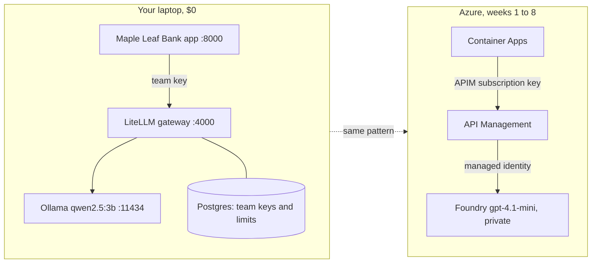

# Week 0: Set up, and build the whole platform on your laptop first ($0)

**Goal:** understand the shape of an enterprise AI platform before you spend a cent in Azure. You run the same three layers locally: the app, an AI gateway, and a model.

## Why start local

Every week in Azure maps to something you can see here in miniature. When APIM returns a 429 in week 4, you'll already know why, because LiteLLM did the same thing on your laptop.



| Local (this week) | Azure (later) | Week |
| --- | --- | --- |
| LiteLLM proxy | API Management AI gateway | 4 |
| Team key with `rpm_limit` / `tpm_limit` | APIM product + subscription with `llm-token-limit` | 4 |
| `model_name: gpt-4.1-mini` alias | Foundry deployment named `gpt-4.1-mini` | 2 |
| Ollama | Microsoft Foundry model | 2 |
| Docker network | VNet + private endpoints | 1, 2 |

## Part A: tools (30 minutes)

| Tool | Why | Install |
| --- | --- | --- |
| Docker Desktop | Local lab | [docker.com](https://www.docker.com/products/docker-desktop/) |
| Azure CLI 2.60+ | Every Azure step | [Install the Azure CLI](https://learn.microsoft.com/en-us/cli/azure/install-azure-cli) |
| Bicep CLI | `az bicep install` | Comes with the Azure CLI |
| make, git, Python 3.11+ | Commands and scripts | Your OS package manager |
| An SSH key | Week 2 test VM | `ssh-keygen -t ed25519` |
| An Azure subscription you own | Weeks 1 to 8 | A personal pay-as-you-go subscription. **Not your employer's.** |

## Part B: the local lab (1 hour)

```bash
git clone https://github.com/vnigam1985/azure-ai-platform-architect.git
cd azure-ai-platform-architect
make local-up      # app, gateway, Postgres, Ollama; pulls a 2 GB model the first time
make local-keys    # creates the app's team key: 20 requests/min, 20,000 tokens/min
make local-test    # 6 checks
```

Expected:

```
PASS  no key is refused (401)
PASS  wrong key is refused (401)
PASS  team key works (200)
PASS  team key can't use other models (403)
PASS  3rd call in a minute is throttled (429)
PASS  app answers through the gateway
6 passed, 0 failed
```

Then open http://localhost:8000 and ask "How much is an international wire transfer?"

### Read the config

Open [local/litellm-config.yaml](../../local/litellm-config.yaml). Notice:

- Apps ask for `gpt-4.1-mini`. The gateway decides what serves it. That's how platform teams swap models without touching apps.
- There's an admin key (only you) and team keys (one per app). Apps never get the admin key.
- `fallbacks` sends traffic to the `mock` model if Ollama is down. Stop Ollama (`docker compose stop ollama`) and ask the app a question. You get the mock answer. That's a failover, the same idea as an APIM backend pool.

## Part C: Azure guardrails before anything else (15 minutes)

```bash
az login
make check          # read this carefully: right subscription?
make week0          # creates the resource group and a budget with email alerts
```

The budget emails you at 50% and 90% of actual spend, and when the forecast passes 100%. A budget never stops spending. **`make destroy` stops spending.**

Region is **Canada East** by default. It has `gpt-4.1-mini` as a Standard (regional) deployment; Canada Central doesn't (checked October 2026). Change it with `LOCATION=...` if you need to, and check [model availability](https://learn.microsoft.com/en-us/azure/foundry/foundry-models/concepts/deployment-types) first.

## Check your work

- [ ] `make local-test` shows 6 passed
- [ ] You watched a fallback happen with Ollama stopped
- [ ] `make check` shows your own subscription, and you got the budget email confirmation or can see the budget in Cost Management

## Interview angle

"Before I touch a cloud, I model the request path: who calls, through what, with which identity, and what happens when a limit is hit. I prototype that locally so the cloud build is about controls, not discovery."

## Go deeper

- [LiteLLM proxy config](https://docs.litellm.ai/docs/proxy/configs)
- [AI gateway capabilities in Azure API Management](https://learn.microsoft.com/en-us/azure/api-management/genai-gateway-capabilities)
