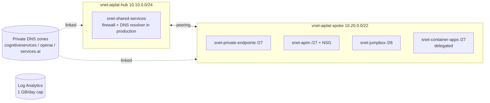

# Week 1: A mini landing zone for AI

**Goal:** the network, DNS and logging foundation that every later week plugs into. If you know hub-spoke already, this week is fast. Focus on the DNS part: it's where most private AI deployments break.



## Deploy (5 minutes)

```bash
make week1
```

## What you built, and why each piece is there

| Resource | Why an AI platform needs it |
| --- | --- |
| Spoke subnets sized per service | APIM needs its own subnet with an NSG and **no** delegation. Container Apps needs a delegated /27 or bigger. Private endpoints get their own small subnet |
| `defaultOutboundAccess: false` on the endpoint and VM subnets | New subnets should be private by default. The VM in week 2 needs no internet at all |
| Three Foundry DNS zones | A Foundry resource answers on three host names. Miss one zone and some SDK calls go to the public IP and fail |
| Zones linked to both VNets | Lab shortcut. In production the zones live in the connectivity subscription, linked to the hub, with a DNS Private Resolver |
| Log Analytics with a daily cap | Every week sends logs here. The cap stops a logging mistake from costing real money |

## Check your work

```bash
az network vnet list -g rg-aiplat-lab -o table
az network private-dns zone list -g rg-aiplat-lab -o table
az network private-dns link vnet list -g rg-aiplat-lab -z privatelink.openai.azure.com -o table
```

- [ ] 2 VNets, peering state **Connected** both ways
- [ ] 3 private DNS zones, each with 2 links
- [ ] The APIM NSG has the 3443, 6390 and outbound rules (read them in the portal and say out loud what each is for)

## Break it on purpose

1. Remove the `link-spoke` link from `privatelink.openai.azure.com`. In week 2, run the private test again. What does DNS return now?
2. Put it back with `make week1`. Bicep is your source of truth: running it again fixes drift.

## Production differences (say these in interviews)

- Hub has Azure Firewall (or a vWAN secured hub with routing intent). Spoke route tables send `0.0.0.0/0` to it
- Central DNS: zones in the connectivity subscription, DNS Private Resolver, and Azure Policy (DeployIfNotExists) that creates the DNS records for every new private endpoint
- Built with [Azure Verified Modules](https://aka.ms/avm) or the [AI Landing Zones](https://learn.microsoft.com/en-us/training/modules/intro-ai-landing-zones/) accelerator, not hand-written like here

More detail in this repo: [private-dns-zones.md](../../networking/private-dns-zones.md), [dns-troubleshooting.md](../../networking/dns-troubleshooting.md), [egress-and-vwan.md](../../networking/egress-and-vwan.md).

## Cost

About USD 1.50 a month for the DNS zones, plus Log Analytics ingestion (the first 5 GB a month is free). VNets, peering inside a region and NSGs cost nothing at this size.

## Resume bullet

> Designed a hub-spoke network foundation for private AI workloads in Bicep, including service-specific subnets, NSGs for API Management, and centralized private DNS for Microsoft Foundry endpoints.

## Go deeper

- [Baseline Microsoft Foundry chat in an Azure landing zone](https://learn.microsoft.com/en-us/azure/architecture/ai-ml/architecture/baseline-microsoft-foundry-landing-zone)
- [Configure private link for Microsoft Foundry](https://learn.microsoft.com/en-us/azure/foundry/how-to/configure-private-link)
