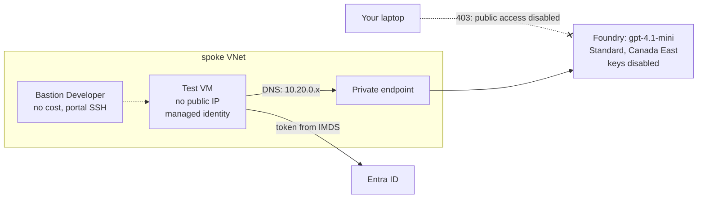

# Week 2: A private model endpoint, and proof that it's private

**Goal:** deploy `gpt-4.1-mini` in Microsoft Foundry with no public access and no API keys, then prove both claims from inside and outside the network. "It's private" is a claim. A test is evidence.



## Deploy (10 to 15 minutes)

```bash
make week2      # uses ~/.ssh/id_ed25519.pub; set SSH_KEY=... to change
```

This reuses the roadmap's [iac/bicep/foundry-private](../../iac/bicep/foundry-private/main.bicep) module and adds a test VM. Two guardrails are on from the start:

| Setting | Effect |
| --- | --- |
| `disableLocalAuth: true` | No API keys exist. Every caller needs an Entra ID token and a role |
| `publicNetworkAccess: Disabled` | Only the private endpoint answers |
| Deployment type `Standard` | Prompts are processed in the region you chose. `GlobalStandard` may process anywhere |

## Prove it (the important part)

```bash
make week2-test
```

This sends [prove-private.sh](../../infra/week02-private-model/prove-private.sh) to the VM with `az vm run-command`, so you don't even need to SSH in. Expected:

```
== 1. DNS ==
ais-aiplat-xxxxxx.openai.azure.com -> 10.20.0.4
PASS private IP
== 2. Token from managed identity ==
PASS got a token (1800 chars)
== 3. Call the model over the private endpoint ==
HTTP 200
Answer: Hello from a private endpoint!
```

Now from your laptop:

```bash
FOUNDRY=$(az cognitiveservices account list -g rg-aiplat-lab --query "[0].name" -o tsv)
curl -s -o /dev/null -w '%{http_code}\n' "https://$FOUNDRY.openai.azure.com/openai/v1/models" \
  -H "Authorization: Bearer $(az account get-access-token --resource https://cognitiveservices.azure.com --query accessToken -o tsv)"
```

You should get **403**, even with a valid token. Your identity is fine; your network path isn't allowed.

Optional: open the VM in the portal, choose **Connect > Bastion**, and log in with your SSH private key. Run `getent hosts $FOUNDRY.openai.azure.com` yourself.

## How the VM calls the model with no keys

1. The VM has a user-assigned managed identity
2. That identity has **Cognitive Services OpenAI User** on the Foundry resource (data-plane only: call models, can't change anything)
3. The VM asks the instance metadata service (169.254.169.254) for a token. No secret is stored anywhere
4. It calls the OpenAI v1 endpoint, `https://<name>.openai.azure.com/openai/v1/chat/completions`, with `model` set to the deployment name. No `api-version` needed on v1

## Break it on purpose

1. Remove the VM identity's role assignment in the portal and run `make week2-test`. What status code do you get now? (Answer: 401 or 403, with a message about permissions. Learn to tell an identity problem from a network problem.)
2. Run `make week2` again to put it back.

## Cost

| Item | About (USD, October 2026) |
| --- | --- |
| Private endpoint | 7.30/month |
| Test VM B2ats_v2 | 0.0094/hour, about 6.90/month if left on. It shuts down at 19:00 every day |
| Bastion Developer | No cost |
| gpt-4.1-mini tokens | Cents for the whole course |

`make stop` deallocates the VM right away.

## Resume bullet

> Deployed Microsoft Foundry models with public access and API keys disabled, reachable only through private endpoints, and verified isolation with automated DNS, identity and network tests.

## Go deeper

- [Deployment types and data processing locations](https://learn.microsoft.com/en-us/azure/foundry/foundry-models/concepts/deployment-types)
- [Configure private link for Microsoft Foundry](https://learn.microsoft.com/en-us/azure/foundry/how-to/configure-private-link)
- [Bastion Developer quickstart](https://learn.microsoft.com/en-us/azure/bastion/quickstart-developer)
