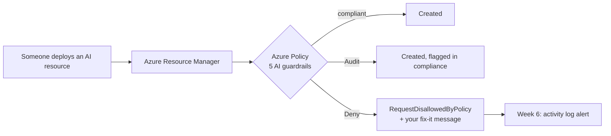

# Week 3: Guardrails as code with Azure Policy

**Goal:** make the week 2 rules impossible to break. Not "please don't use API keys" in a wiki, but Azure refusing the deployment. This is the week where your Azure Policy experience becomes AI platform experience.



## The 5 guardrails

| # | Rule | Policy | Effects |
| --- | --- | --- | --- |
| 1 | No API keys, Entra ID only | Built-in `71ef260a` | Audit, Deny |
| 2 | No public network access | Built-in `037eea7a` | Audit, Deny |
| 3 | Private Link used | Built-in `d6759c02` | Audit only |
| 4 | Approved models only | Built-in `aafe3651` ("Foundry model deployments should only use approved models") | Audit, Deny |
| 5 | Regional deployment types only (data residency) | Custom, [this repo](../../governance/policy-definitions/deny-global-deployments-for-residency.json) | Audit, Deny |

IDs and names checked October 29, 2026. Built-in names change; IDs don't. Always store IDs.

## Deploy the way real teams do: Audit first

```bash
make week3-audit
# wait about 15 minutes for the assignments to take effect, then:
make week3-compliance
```

Your week 2 resources should be **compliant**. If anything shows non-compliant, read why before you move on.

Then turn on enforcement:

```bash
make week3-deny
# wait about 15 minutes, then try to break the rules:
make week3-test
```

[test-guardrails.sh](../../infra/week03-policy/test-guardrails.sh) runs `az deployment group validate` against [deliberately bad resources](../../infra/week03-policy/bad-examples.bicep). Validate runs the policy check **without creating anything**, so the test is free. Expected:

```
PASS  denied: AI Services with API keys enabled
      by "AI: key access disabled (Entra ID only)"
PASS  denied: AI Services with public network access
PASS  denied: Global deployment type (residency)
PASS  denied: Model not on the approved list
4 passed, 0 failed
```

### Honest note on test 4

The approved-models built-in runs in a special mode (`Microsoft.CognitiveServices.Data`). Microsoft documents it as evaluated "at deployment time", and it may not show up in a validate-only call. If test 4 fails, try a real deployment of `gpt-4.1-nano` in the Foundry portal. It should be blocked with a policy message. Write down what you saw. That's real platform engineering: test the control, don't trust the docs.

Also check how the publisher parameter behaves. This lab sets only `allowedAssetIds` (`gpt-4.1-mini/`, where the trailing slash means exactly that model) and leaves `allowedPublishers` empty. If your allowed model is blocked too, redeploy with a publisher and test again, then decide what you'd recommend:

```bash
az deployment sub create -l canadaeast -f infra/week03-policy/main.bicep \
  -p resourceGroupName=rg-aiplat-lab effect=Deny allowedModelPublishers='["OpenAI"]'
```

## The process matters more than the JSON

Read [governance/README.md](../../governance/README.md) for the rollout steps interviewers ask about:

1. Resolve and store built-in IDs
2. Assign in **Audit** at the AI landing zones management group
3. Publish compliance to workload teams, give them 2 to 4 weeks
4. Exemption process with an owner, an expiry date and a review
5. Switch to **Deny** on an announced date
6. Manage everything as code (EPAC or a pipeline)

Every assignment here carries a `nonComplianceMessage` that tells people how to fix the problem. A deny without a fix-it message creates support tickets.

## Check your work

- [ ] `make week3-compliance` shows week 2 resources compliant
- [ ] `make week3-test` shows at least 3 of 4 denied, and you investigated test 4
- [ ] You can explain why Private Link is Audit-only (the built-in doesn't support Deny)

## Cost

Azure Policy is free.

## Resume bullet

> Codified AI guardrails in Azure Policy (Entra-only auth, no public endpoints, approved models, regional data residency), rolled out Audit-then-Deny, and verified enforcement with automated negative tests.

## Go deeper

- [Control model deployment with Azure Policy](https://learn.microsoft.com/en-us/azure/foundry/how-to/model-deployment-policy)
- [Azure Policy overview](https://learn.microsoft.com/en-us/azure/governance/policy/overview)
- [Enterprise Azure Policy as Code (EPAC)](https://azure.github.io/enterprise-azure-policy-as-code/)
