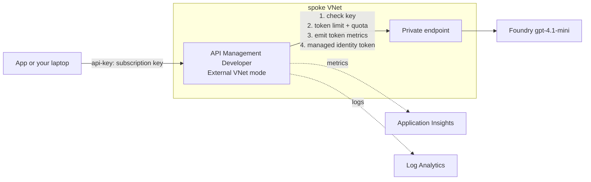

# Week 4: The AI gateway (Azure API Management)

**Goal:** one front door for every app that wants a model. Apps get a gateway key with a token budget. Only the gateway can reach the model, and it does so with its own identity. This is the single most important pattern for running AI at company scale.



## Deploy (30 to 40 minutes, start it and go do something else)

```bash
make week4
```

API Management takes a long time to create, especially inside a VNet. That's normal.

## What the gateway does on every request

From [policy.xml](../../infra/week04-ai-gateway/policy.xml):

| Step | Policy | What the caller sees when it trips |
| --- | --- | --- |
| Is there a valid subscription key in `api-key`? | Built into APIM | 401 |
| Route to Foundry | `set-backend-service` | |
| Authenticate as APIM, not as the app | `authentication-managed-identity` | |
| Over 5,000 tokens per minute for this subscription? | `llm-token-limit` | 429 with `Retry-After` |
| Over the monthly quota? | `llm-token-limit` (`token-quota`) | 403 |
| Count tokens per subscription and team | `llm-emit-token-metric` | |
| Retry a throttled or failed backend | `retry` | |

The token limit is low on purpose so you can trigger it. Change `tokensPerMinute` when you redeploy.

## Test it

```bash
make week4-test
```

Expected:

```
PASS  no subscription key is refused (401)
PASS  app key works (200)
      answer: A bank AI gateway controls and secures access to AI models...
      x-remaining-tokens: 4950
      sending large requests until the token limit kicks in...
PASS  token limit returns 429
      retry-after: 42
PASS  Foundry is NOT reachable directly from the internet (403)
4 passed, 0 failed
```

Notice the last test: your laptop reaches the model **through** APIM, but not directly. The gateway is now the only door.

## Design choices to understand (and defend in an interview)

**External vs Internal VNet mode.** This lab uses External: the gateway has a public endpoint so you can test from your laptop, and it reaches Foundry through the VNet. Banks usually use Internal mode (no public gateway endpoint) behind Application Gateway with WAF, or the v2 tiers with private endpoints for inbound traffic. Developer tier is for learning only: no SLA, one unit.

**How the API is defined.** This Bicep builds the API by hand: an HTTP API at `/ai/openai/v1` with `chat/completions` and `models` operations. Microsoft's documented route is to import the Foundry resource in the portal, choosing the "Azure OpenAI v1" compatibility option, which builds the same shape. If the token headers (`x-remaining-tokens`) don't appear in your test, import the API from the portal instead and compare. Tell us in an issue what you found.

**Why `api-key` as the header name.** OpenAI SDKs can send it as a default header, so apps only change their base URL and key. The bank app sets it from `APIM_SUBSCRIPTION_KEY`.

**Streaming.** For streamed responses, clients must send `stream_options: {"include_usage": true}` or the token counts can be missing.

## Check your work

- [ ] `make week4-test` shows 4 passed
- [ ] In the portal, APIM > APIs > Bank AI > Test, you can call chat completions
- [ ] You can explain what happens when two apps share a model and one of them goes into a loop

## Cost

API Management Developer is about **USD 48 a month** (USD 0.0658 per hour, October 2026) for as long as it exists. It can't be paused. Plan weeks 4 to 8 close together, then `make destroy`.

## Resume bullet

> Built an AI gateway on Azure API Management in front of private Foundry models: managed-identity backend auth, per-application token limits and quotas, and token metrics for chargeback, all in Bicep.

## Go deeper

- [AI gateway capabilities in API Management](https://learn.microsoft.com/en-us/azure/api-management/genai-gateway-capabilities)
- [llm-token-limit policy](https://learn.microsoft.com/en-us/azure/api-management/llm-token-limit-policy) and [llm-emit-token-metric policy](https://learn.microsoft.com/en-us/azure/api-management/llm-emit-token-metric-policy)
- [Import a Microsoft Foundry API](https://learn.microsoft.com/en-us/azure/api-management/azure-ai-foundry-api)
- [Use a virtual network with API Management](https://learn.microsoft.com/en-us/azure/api-management/api-management-using-with-vnet)
- More policies in this repo: [gateway/](../../gateway/README.md) (content safety, semantic cache, backend pools)
