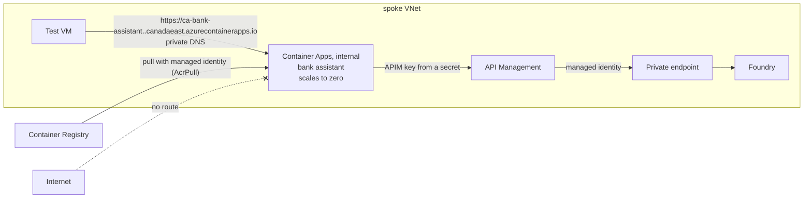

# Week 5: Run the bank assistant privately

**Goal:** host a real AI workload on your platform. The Maple Leaf Bank assistant (a RAG chatbot plus an agent that can move money) runs on Azure Container Apps inside the VNet, and it can only reach the model through your gateway.



## Deploy (10 to 15 minutes)

```bash
make week5
```

It runs in three steps:

1. Creates the registry, the app identity (with AcrPull) and the internal Container Apps environment, plus a private DNS zone for it
2. `az acr build` builds [app/Dockerfile](../../app/Dockerfile) **in Azure**. You don't need Docker running
3. Creates the app, with the APIM subscription key stored as a Container Apps secret

If step 2 fails with a message that ACR Tasks aren't available for your subscription type, build and push locally instead:

```bash
ACR=$(az acr list -g rg-aiplat-lab --query "[0].name" -o tsv)
az acr login -n $ACR
docker build -f app/Dockerfile -t $ACR.azurecr.io/maple-bank-assistant:v1 . && docker push $ACR.azurecr.io/maple-bank-assistant:v1
```

Then run `make week5` again.

## Test it

```bash
make week5-test
```

Expected (the first call can take about 20 seconds while the app scales up from zero):

```
== DNS ==
10.20.1.x   ca-bank-assistant.<something>.canadaeast.azurecontainerapps.io
== Health ==
{"status":"ok","chunks":8,"mode":"llm"}
== Ask a question through app -> APIM -> private Foundry ==
Answer: An international wire transfer costs $30 per transfer. (wording varies)
Mode: llm | latency ms: 1450
== Agent: money moves only with confirmation ==
Answer: (the model's wording varies)
Tool calls: [{'name': 'transfer_funds', 'arguments': {'from_account': 'CHQ-1001', 'to_account': 'SAV-2002', 'amount': 200.0}, 'result': {'status': 'needs_confirmation'}}]
```

## Count the secrets

Here's every credential in the request path:

| Hop | How it authenticates | Secret stored? |
| --- | --- | --- |
| Container Apps pulls the image | Managed identity + AcrPull | No |
| App calls APIM | APIM subscription key | Yes, one, in a Container Apps secret |
| APIM calls Foundry | APIM managed identity | No |
| VM calls Foundry (week 2) | Managed identity | No |

One secret, and it's a gateway key you can rotate or revoke per app without touching the model. **Stretch goal:** remove it too. Have the app get an Entra token with its managed identity and make APIM check it with the `validate-azure-ad-token` policy.

## Break it on purpose

1. In the portal, regenerate the primary key of the `retail-banking-app` subscription in APIM. Run `make week5-test`. The app fails with 401. That's how you'd cut off a misbehaving app in seconds.
2. Run `make week5` to put the new key back into the app.

## Check your work

- [ ] `make week5-test` answers with `"mode":"llm"`
- [ ] The transfer needs confirmation (the platform enforces it in code, not in the prompt)
- [ ] From your laptop, the app's address doesn't resolve or connect

## Cost

| Item | About (USD, October 2026) |
| --- | --- |
| Container Registry Basic | 5/month |
| Container Apps (Consumption, scales to zero) | Usually within the monthly free grant for a lab |
| Extra private DNS zone | 0.50/month |

## Resume bullet

> Deployed a containerized RAG and agent application on internal Azure Container Apps with managed-identity image pulls, private DNS, and model access only through an API Management AI gateway.

## Go deeper

- [Container Apps with an internal virtual network](https://learn.microsoft.com/en-us/azure/container-apps/vnet-custom-internal)
- [Networking in Container Apps](https://learn.microsoft.com/en-us/azure/container-apps/custom-virtual-networks)
