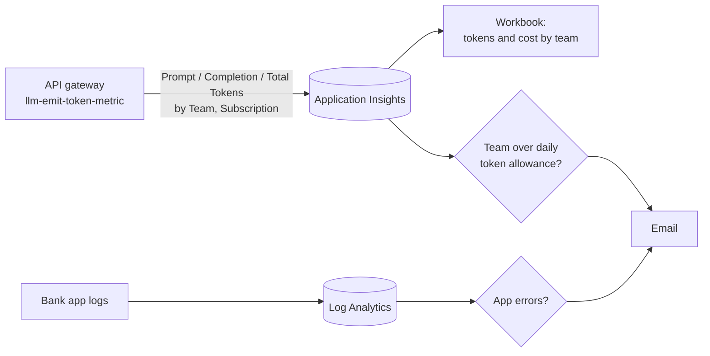

# Week 7: Observability and FinOps

**Goal:** answer the two questions every AI platform owner gets asked in the first month: "which team is spending what?" and "is the app healthy?" With numbers, not guesses.



## Before you deploy: one portal setting

Token metrics carry dimensions (Team, Subscription ID). Application Insights only keeps custom metric dimensions if you allow it:

**Application Insights `appi-aiplat` > Usage and estimated costs > Custom metrics > "Enable alerting on custom metric dimensions"** (the wording can differ slightly in the portal).

## Deploy (2 minutes)

```bash
make week7
```

Then generate some traffic so there's something to see:

```bash
make week4-test && make week5-test
```

Metrics take a few minutes to show up.

## Use the workbook

Portal > Monitor > Workbooks > **AI platform: tokens and cost by team**.

| Panel | Use it for |
| --- | --- |
| Tokens by team | Showback: who uses what |
| Total tokens per hour | Spot loops and spikes |
| Estimated cost by team | Chargeback. Type your model's current prices into the two boxes at the top |
| Responses by status code | 429s mean a team needs a bigger budget or has a bug. 401/403 means blocked traffic |
| Which metric names does my gateway emit? | **Run this first.** If your gateway emits different names than `Prompt Tokens` / `Completion Tokens` / `Total Tokens`, edit the queries |

Cost here is an **estimate** from token counts. Your invoice is the truth. Get current per-token prices from the Azure pricing page for your model, region and deployment type. The defaults in the workbook are placeholders, not quotes.

## The alerts

| Alert | Fires when | Change it with |
| --- | --- | --- |
| Team over daily token allowance | One team uses more than 200,000 tokens in 24 hours | `dailyTokenAllowance` |
| Bank app errors | 5+ error lines in the app logs in 15 minutes | Edit the query |

## FinOps decisions you should be able to make

1. **Pay-as-you-go or provisioned throughput (PTU)?** Read [finops/ptu-vs-paygo.md](../../finops/ptu-vs-paygo.md). For this lab, pay-as-you-go wins by a mile.
2. **Token budgets per team.** Week 4's `llm-token-limit` is the hard control. This week's alert is the early warning.
3. **Cheaper model for easy work.** Would `gpt-4.1-nano` be good enough for the bank FAQ? You'd need to add it to the approved-model policy (week 3), the model inventory (week 8), and prove quality with the eval gate (week 8). That's the full change process in one sentence.
4. **Kill idle cost.** The biggest cost in this lab is APIM sitting idle. `make destroy` when you're done for the week.

More queries: [finops/token-cost-queries.kql](../../finops/token-cost-queries.kql).

## Check your work

- [ ] The workbook shows tokens for team `retail-banking-app`
- [ ] You set real prices and got an estimated cost
- [ ] You lowered `dailyTokenAllowance` to 1,000, redeployed, generated traffic, and got the alert

## Cost

Workbooks are free. Log alert rules cost a small amount per rule per month. Application Insights charges per GB ingested; this lab sends very little.

## Resume bullet

> Built AI FinOps reporting from API gateway token metrics: per-team token usage, estimated cost showback, and daily allowance alerts, delivered as code with an Azure Workbook and Azure Monitor alerts.

## Go deeper

- [llm-emit-token-metric policy](https://learn.microsoft.com/en-us/azure/api-management/llm-emit-token-metric-policy)
- [Provisioned throughput concepts](https://learn.microsoft.com/en-us/azure/foundry/openai/concepts/provisioned-throughput)
- [Azure Well-Architected for AI workloads](https://learn.microsoft.com/en-us/azure/well-architected/ai/get-started)
