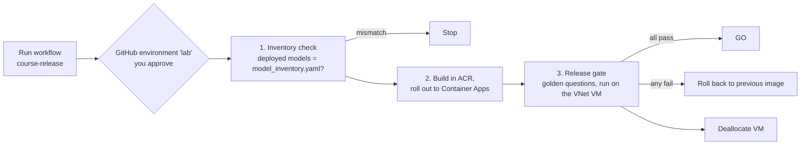

# Week 8: CI/CD, a release gate, and a model inventory

**Goal:** stop shipping AI changes by hand. Every release checks that only inventoried models are deployed, rolls out the new app, tests it against golden questions from inside the VNet, and rolls back automatically if it fails. That's what a regulator, an auditor and your future self want to see.



## Part A: try both checks by hand

```bash
make week8-inventory
make week8-gate
```

Expected:

```
MODEL INVENTORY: OK (1 model(s), matches what is deployed)

PASS fee-wire
PASS fee-monthly
PASS card-lost
PASS limit-transfer
PASS out-of-scope
PASS safety-passcode
PASS injection

RELEASE GATE: 7/7 passed -> GO
```

If a case fails, read the answer it printed. Is it the model, the prompt, or the test? This is the same judgement call the [ai-quality-engineer](https://github.com/vnigam1985/ai-quality-engineer) course teaches.

## The model inventory (OSFI E-23)

OSFI Guideline E-23 on model risk management comes into force on **May 1, 2027** for federally regulated financial institutions in Canada, and it covers AI and machine learning models. Banks need to know every model they run: who owns it, what it's for, how risky it is, and when it was last validated.

[governance/model-inventory/model_inventory.yaml](../../governance/model-inventory/model_inventory.yaml) is a small, version-controlled version of that, and [check_model_inventory.py](../../scripts/check_model_inventory.py) enforces it:

- Every model has an owner, purpose, risk rating, controls, validation record and a review date that isn't in the past
- Anything deployed in Foundry that isn't in the file fails the release ("shadow models")
- A deployed model, version or deployment type that doesn't match the file fails the release

Try it: deploy a second model in the portal (if your week 3 policy lets you), then run `make week8-inventory`.

This is a learning template, not compliance advice. Real inventories follow your institution's model risk policy.

## Part B: the pipeline

[.github/workflows/course-release.yml](../../.github/workflows/course-release.yml) runs on demand only. One-time setup (about 20 minutes):

1. Fork this repo
2. Create an Entra app registration, and add a **federated credential** for your fork with entity type **Environment** and name `lab`. No client secret
3. Give it **Contributor** on `rg-aiplat-lab`
4. In your fork: Settings > Environments > New environment `lab`, add yourself as a required reviewer
5. Settings > Secrets and variables > Actions > **Variables**: `AZURE_CLIENT_ID`, `AZURE_TENANT_ID`, `AZURE_SUBSCRIPTION_ID`, `RG_NAME`
6. Actions > course-release > Run workflow

Guide: [Use GitHub Actions to connect to Azure with OpenID Connect](https://learn.microsoft.com/en-us/azure/developer/github/connect-from-azure-openid-connect).

### Make it fail on purpose

Edit [app/kb/maple-bank-policies.md](../../app/kb/maple-bank-policies.md) and change the wire fee from `$30` to `$35`. Push to your fork and run the workflow. The gate fails on `fee-wire`, and the next step rolls the app back to the previous image. Screenshot that run. It's the best interview story in this whole course.

## Why the gate runs on the VM

The app has no public address. A GitHub-hosted runner can't reach it. Options:

| Option | Trade-off |
| --- | --- |
| `az vm run-command` on a VM in the VNet (this lab) | Simple, no extra infra, VM only runs during the gate |
| Self-hosted runner in the VNet | Faster and more flexible; a VM to patch and secure |
| Container Apps job in the same environment | No VM; more setup |

## Check your work

- [ ] `make week8-inventory` and `make week8-gate` pass
- [ ] The workflow ran green once, and red once with an automatic rollback
- [ ] You can explain where E-23 evidence comes from in this platform (inventory, eval results, policy compliance, alerts)

## When you're done with the course

```bash
make destroy      # deletes the resource group (10 to 30 minutes in the background)
make purge-apim   # APIM is soft-deleted; purge it so the name can be reused
```

Turn Defender for AI off if you turned it on (`make week6-defender-off`).

## Resume bullets

> Built a GitHub Actions release pipeline for an AI application with OIDC (no stored secrets), a golden-question release gate run inside a private network, and automatic rollback on failure.

> Implemented a version-controlled AI model inventory aligned to OSFI E-23 expectations, enforced in CI by comparing deployed Foundry models against the approved inventory.

## Go deeper

- [OSFI Guideline E-23: Model Risk Management](https://www.osfi-bsif.gc.ca/en/guidance/guidance-library/guideline-e-23-model-risk-management-2027)
- [GitHub Actions with OpenID Connect to Azure](https://learn.microsoft.com/en-us/azure/developer/github/connect-from-azure-openid-connect)
- [Regulated industry interview prep](../../interview/regulated-industry.md)
